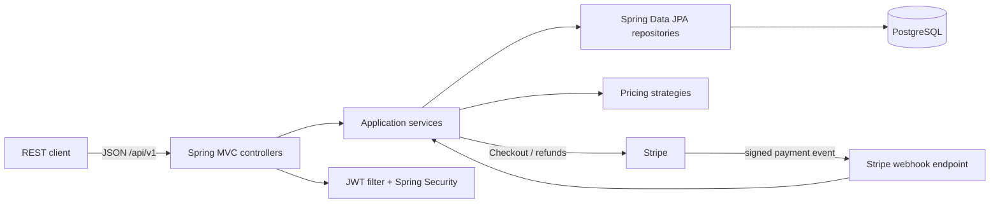
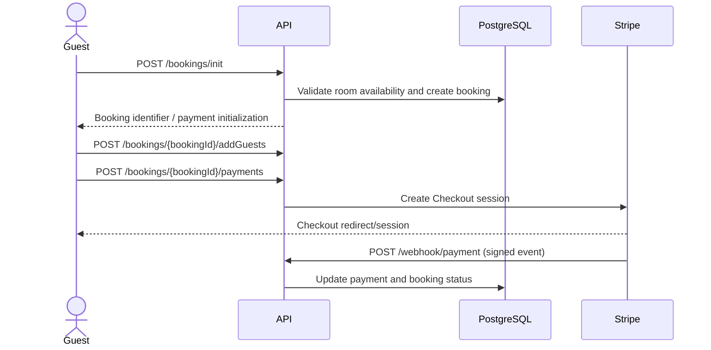

# AirBnB

A Spring Boot REST API for managing hotels, rooms, availability, reservations, guests, payments, and hotel operations. This is a learning project inspired by Airbnb; it currently models hotel and room inventory rather than Airbnb-style home listings.

## Contents

- [PRD](#product-requirements-prd)
- [Architecture](#architecture)
- [Design and domain model](#design-and-domain-model)
- [API overview](#api-overview)
- [Rules and security](#rules-and-security)
- [Tasks](#tasks)
- [Project memory](#project-memory)

## Product requirements (PRD)

### Problem

Hotel operators need a backend to publish properties and rooms, maintain daily availability and pricing, and manage bookings. Travelers need to discover hotels, reserve rooms for a date range, provide guest details, pay, and manage their profile and reservations.

### Users

- **Traveler / guest:** searches hotels, views hotel information, books rooms, adds guests, pays, checks reservation status, and manages profile and saved guest information.
- **Hotel manager:** manages hotels, rooms, inventory, prices, and operational booking/report views.
- **Payment provider:** Stripe Checkout processes payment; Stripe webhooks report payment completion to the API.

### In-scope capabilities (present in source)

- Authentication using signup, login, token refresh, JWT, and role-aware authorization.
- Hotel and room management, including activation and administrative views.
- Hotel search and hotel information retrieval.
- Room inventory updates and date-based booking.
- Guest details associated with a booking.
- Booking status, cancellation, Stripe Checkout, webhook handling, and refunds.
- Composable price calculation strategies (base, occupancy, urgency, surge, holiday) and scheduled price updates.
- Hotel booking and report endpoints.

## Architecture

The code follows a controller → service → repository structure. Controllers expose REST routes and DTOs; services implement booking, hotel, user, inventory, checkout, and pricing behavior; repositories persist JPA entities. Global response and exception handlers standardize API responses. The configured API context path is `/api/v1`.

### Main technology

- Java 21, Spring Boot 3.4.0, Spring MVC
- Spring Data JPA / Hibernate and PostgreSQL
- Spring Security, BCrypt, and JJWT 0.12.6
- Stripe Java SDK 28.2.0
- ModelMapper, Lombok, springdoc OpenAPI
- Maven Wrapper

## Design and domain model

The central entities in the supplied source are `User`, `Hotel`, `HotelContactInfo`, `Room`, `Inventory`, `Booking`, and `Guest`. Bookings refer to a room and date range; guest records are associated with reservations. Inventory represents room availability and pricing by date. Users have roles, and bookings/payments have status enums.

The supplied Airbnb booking flow diagram represents this lifecycle:

## API overview

All routes below are relative to `/api/v1`. Exact request/response DTOs and authorization should be checked in the corresponding controller and OpenAPI UI.

| Area | Routes found in source | Purpose |
|---|---|---|
| Authentication | `POST /auth/signup`, `/auth/login`, `/auth/refresh` | Create account, authenticate, refresh token |
| Hotels (public) | `GET /hotels/search`, `GET /hotels/{hotelId}/info` | Search and view hotel information |
| Bookings | `POST /bookings/init`, `POST /bookings/{bookingId}/addGuests`, `POST /bookings/{bookingId}/payments`, `POST /bookings/{bookingId}/cancel`, `GET /bookings/{bookingId}/status` | Reservation lifecycle and payment initiation |
| User | `PATCH /users/profile`, `GET /users/profile`, `GET /users/myBookings` | Profile and current user's bookings |
| Guest details | `GET /users/guests`, `POST /users/guests`, `PUT /users/guests/{guestId}`, `DELETE /users/guests/{guestId}` | Manage saved guests |
| Admin hotels | `/admin/hotels` and `/admin/hotels/{hotelId}` with GET/POST/PUT/DELETE; `PATCH /admin/hotels/{hotelId}/activate`; hotel bookings and reports GET routes | Hotel manager operations |
| Admin rooms | `/admin/hotels/{hotelId}/rooms` with GET/POST; GET/PUT/DELETE `/.../rooms/{roomId}` | Room management |
| Admin inventory | `GET /admin/inventory/rooms/{roomId}`, `PATCH /admin/inventory/rooms/{roomId}` | Inspect/update room inventory |
| Payments webhook | `POST /webhook/payment` | Receive Stripe payment event |

## Rules and security

Rules visible in the implementation:

1. Routes under `/admin/**` require the `HOTEL_MANAGER` role.
2. `/bookings/**` and `/users/**` require an authenticated user.
3. Other routes are permitted by the configured security chain; individual service/controller validation still applies.
4. Security is stateless. The JWT filter authenticates bearer tokens, and BCrypt encodes passwords.
5. The Stripe webhook verifies the `Stripe-Signature` header against the webhook secret.
6. Cancellation logic accepts confirmed bookings and attempts to release inventory and issue a Stripe refund.
7. Pricing is composed from strategy implementations; the source schedules a pricing update hourly.
8. API errors and normal responses pass through shared response/exception handling.

### Prerequisites

- JDK 21
- PostgreSQL
- Stripe test account and Stripe CLI (for local webhook testing)

## Tasks

### Implemented in the supplied code

- [x] Hotel, room, inventory, user, guest, and booking persistence models
- [x] Hotel and room administration APIs
- [x] Search, booking initialization, guest association, status, and cancellation APIs
- [x] JWT authentication and hotel-manager access control
- [x] Stripe Checkout, webhook processing, and refund integration
- [x] Dynamic pricing strategies and scheduled update job
- [x] Hotel booking/report endpoints

### Next tasks

- [ ] Remove and rotate committed secrets; provide a safe `.env.example` or documented external configuration.
- [ ] Add integration tests for booking availability, concurrent reservations, payment webhooks, authorization, and refunds.
- [ ] Document request/response examples, error codes, pagination, and all booking/payment states.
- [ ] Confirm ownership/authorization policies for user-specific bookings and saved guests.
- [ ] Add database migrations, deployment instructions, observability, and health checks.
- [ ] Add frontend/client documentation if a client application is part of the repository roadmap.

## Project memory

- The product is currently a **hotel booking backend inspired by Airbnb**, with hotel/room/inventory terminology in the source.
- The booking flow is: initialize reservation → attach guests → initiate payment → process Stripe webhook → reflect reservation/payment status; cancellation is a separate flow that includes inventory release and refund handling.

## Thanks for visiting
